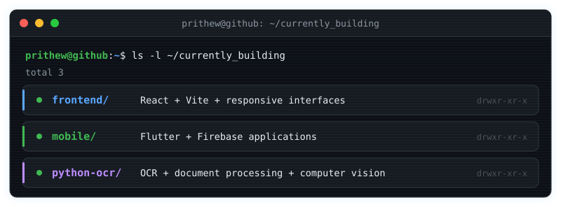
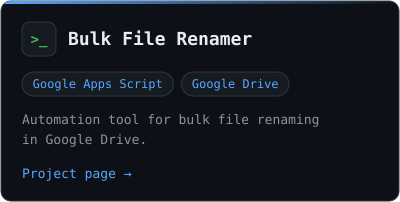
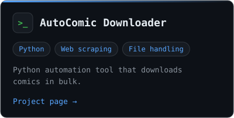
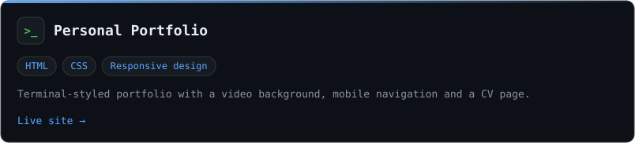
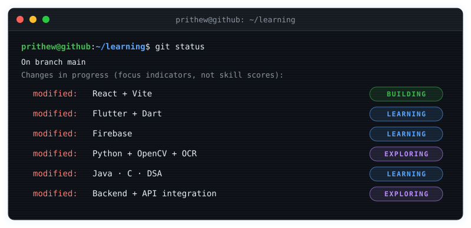

 

<code>role: CSE student</code> · <code>focus: frontend + mobile + OCR</code> · <code>status: building</code>

  

 

## $ ./currently-building

## $ cat skills.txt

<table>
  <tr>
    <td width="24%"><code>frontend</code></td>
    <td></td>
  </tr>
  <tr>
    <td><code>mobile</code></td>
    <td></td>
  </tr>
  <tr>
    <td><code>programming</code></td>
    <td></td>
  </tr>
  <tr>
    <td><code>vision / ocr</code></td>
    <td> &nbsp;+ OCR · document processing</td>
  </tr>
  <tr>
    <td><code>tools</code></td>
    <td></td>
  </tr>
</table>

## $ ls ~/projects

<a href="https://github.com/prithewjraj/portfolio">View portfolio source code →</a>

## $ git status

## $ git log --stat

## $ ./snake --contributions

A snake eats my contribution graph. A GitHub Action regenerates it daily, so it reflects my real activity.

<picture>
  <source media="(prefers-color-scheme: dark)" srcset="https://raw.githubusercontent.com/prithewjraj/prithewjraj/output/github-snake-dark.svg" />
  <source media="(prefers-color-scheme: light)" srcset="https://raw.githubusercontent.com/prithewjraj/prithewjraj/output/github-snake.svg" />
  
</picture>

## $ ./connect

| channel | link |
| :-- | :-- |
| `portfolio` | [prithewjraj.github.io/portfolio](https://prithewjraj.github.io/portfolio/) |
| `resume` | [prithewjraj.github.io/portfolio/resume.html](https://prithewjraj.github.io/portfolio/resume.html) |
| `github` | [github.com/prithewjraj](https://github.com/prithewjraj) |
| `linkedin` | [linkedin.com/in/prithewjraj](https://www.linkedin.com/in/prithewjraj) |
| `email` | [prithewjraj@gmail.com](mailto:prithewjraj@gmail.com) |

Open to internships and collaborations.

